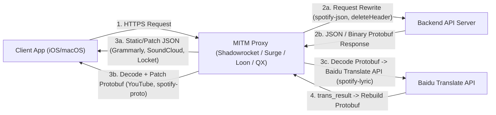

# SHADOW-ROCKET-CONFIG-URL

Kho lưu trữ và tài liệu **phân tích kỹ thuật tĩnh (Reverse Engineering)** đối với bộ 9 URL script MITM thường dùng trên Shadowrocket / Surge / Loon / Quantumult X (gồm **8 script duy nhất**, 1 URL trùng lặp và 1 URL trả về `404`).

> **Mục đích lưu trữ:** Tài liệu hóa cấu trúc mã nguồn, cơ chế xử lý JSON / Protobuf nhị phân, lỗi bảo mật và ranh giới thực tế giữa **can thiệp hiển thị phía client (client-side spoofing)** và **xác thực quyền phía máy chủ (server-side verification)** nhằm phục vụ học tập và phân tích kỹ thuật. Không tạo hay đóng gói module crack/bypass mới.

---

## 1. Danh Sách Thư Mục & Script

| # (URL gốc) | Thư mục | Tác giả / Nguồn | Ứng dụng & Endpoint mục tiêu | Kiểu xử lý | Trạng thái |
| :--- | :--- | :--- | :--- | :--- | :--- |
| 1 | [maasea-youtube-response](./maasea-youtube-response/README.md) | `Maasea/sgmodule` | YouTube & YT Music (`youtubei.googleapis.com/youtubei/v1/*`) | `http-response` (**Protobuf** `@protobuf-ts/runtime` v1.0.8) | `200 OK` |
| 2, 7 *(trùng)* | [yqc007-grammarly-premium](./yqc007-grammarly-premium/README.md) | `yqc007/QuantumultX` (`Hausd0rff`) | Grammarly (`subscription.grammarly.com/api/v1/subscription`) | `http-response` (**JSON** tĩnh toàn phần) | `200 OK` |
| 3 | [marol62926-soundcloud](./marol62926-soundcloud/README.md) | `Marol62926/MarScrpt` | SoundCloud iOS (*api-mobile.soundcloud.com — suy luận từ search*) | `http-response` (**JSON** chọn lọc) | `200 OK` |
| 4 | [duyvinh09-youtube-response](./duyvinh09-youtube-response/README.md) | `duyvinh09/Module_IOS` | YouTube (không truy cập được mã nguồn) | `—` | **`404: Not Found`** |
| 5 | [vuong2023-locket-ohoang7](./vuong2023-locket-ohoang7/README.md) | `vuong2023/shad` (`Ohoang7`) | Locket / RevenueCat (`api.revenuecat.com/.+/(receipts\|subscribers/...)`) | `http-response` (**JSON**) | `200 OK` |
| 6 | [app2smile-spotify-proto](./app2smile-spotify-proto/README.md) | `app2smile/rules` | Spotify (`spclient*/bootstrap/v1/bootstrap`, `user-customization-service/v1/customize`) | `http-response` (**Protobuf** `protobufjs` `light`) | `200 OK` |
| 8 | [app2smile-spotify-json](./app2smile-spotify-json/README.md) | `app2smile/rules` | Spotify (`spclient*/(artistview/v1/artist\|album-entity-view/v2/album)/`) | `http-request` (**URL Rewrite**) | `200 OK` |
| 9 | [app2smile-spotify-lyric](./app2smile-spotify-lyric/README.md) | `app2smile/rules` | Spotify (`spclient.wg.spotify.com/color-lyrics/v2/track/`) | `http-response` (**Protobuf** + Baidu API, kèm [`spotify-lyric.clean.js`](./app2smile-spotify-lyric/spotify-lyric.clean.js)) | `200 OK` |

---

## 2. Kiến Trúc Tổng Quan Cơ Chế MITM Proxy



### Nguyên lý kỹ thuật cốt lõi
1. **Hai pha chặn (`http-request` -> `http-response`):** Pha request dùng để đổi tham số định danh (như `platform=iphone` -> `platform=ipad` ở `spotify-json.js`) hoặc xóa header cache như `if-none-match` (`spotify.module`) để ngăn backend trả HTTP `304 Not Modified` (không có body). Pha response dùng để đọc/ghi JSON (`JSON.parse`) hoặc binary Protobuf (`binary-body-mode=1` truyền `Uint8Array`, Quantumult X truyền `ArrayBuffer` qua `$response.bodyBytes`).
2. **Partial Protobuf Patching vs `protobufjs` `light`:**
   - `@protobuf-ts/runtime` (`maasea` YouTube v1.0.8, `spotify-lyric` v2.9.0) bật `UnknownFieldHandler` (`readUnknownField: true`) để giữ nguyên toàn bộ field nhị phân chưa khai báo trong schema và ghi lại khi gọi `toBinary()`.
   - `protobufjs` `light` (`spotify-proto.js`) dùng JSON descriptor `spotifyJson` (20 message) giải mã, sửa 37 thuộc tính trong `accountAttributes` và đóng gói lại bằng `.encode(...).finish()`.
3. **Ranh giới thực tế (Client-side vs Server-side):** Các cờ giao diện, quảng cáo nhúng trong feed/player đã nhận, trình phát PiP/nền YouTube và trạng thái gói hiển thị trên client bị ảnh hưởng bởi các phản hồi này; ngược lại, tính năng kiểm tra token/quyền trực tiếp trên backend (như AI/ngữ pháp server Grammarly, stream `Very High` của Spotify, DRM/offline phía server) không bị qua mặt.

---

## 3. Phân Tích Khả Năng Thực Thi (`.fmt.js`) & Lỗi Kỹ Thuật Tĩnh

1. **Khả năng chạy của các bản `.fmt.js`:**
   - **Cú pháp:** Toàn bộ `11` file `.js` và `.fmt.js` đều qua kiểm tra cú pháp `node --check` với exit code `0`. Việc beautify không làm đổi ngữ nghĩa AST của JavaScript so với bản minified, nhưng làm tăng kích thước tải/parse (ví dụ `youtube.response.fmt.js` từ `132,973 B` lên `251K`).
   - **Phụ thuộc môi trường:** Không chạy được trực tiếp bằng `node` thuần vì đòi hỏi các biến toàn cục do Shadowrocket / Surge / Loon / Quantumult X tiêm vào (`$request`, `$response`, `$done`, `$httpClient` / `$task`).
   - **Lỗi sẵn có giữ nguyên từ bản gốc:**

| Tệp phân tích | Điểm lỗi kỹ thuật phát hiện | Tác động |
| :--- | :--- | :--- |
| `spotify-proto.fmt.js` (`L2290-L2297`) | Nhánh `else` không có `return` trước `body.buffer.slice(...)` | Gây `TypeError` trên QuanX khi URL không khớp |
| `Locket_Ohoang7.fmt.js` (`L8-L33`) | Không check `User-Agent` null, không `try/catch` JSON, `s === undefined` | Dễ crash khi response lỗi hoặc thiếu header |
| `youtube.response.fmt.js` (`L5574`, `L5615`) | `n[o].baseUrl` khi `captionTracks` rỗng; `ni()` đọc `l[r + n]` ở cuối mảng | Bỏ qua xử lý nếu lỗi `Pi()` thoát vào `catch` của `Ki()` |
| `GrammarlyPremiumCrack.js` / `soundcloud.js` | Thiếu check HTTP status và `try/catch` quanh `JSON.parse` | Exception chưa bắt nếu upstream trả HTML/lỗi mạng |
| `spotify-lyric.fmt.js` (`L2506`, `L2509`, `L2541`) | `split('=')` cắt khóa bí mật, log lộ `$argument`, lệch hoa/thường `Content-Type` | Rò rỉ API key và hỏng key chứa ký tự `=` |

---

## 4. Kiểm Thử Tĩnh & Unit Test Cho Module Hợp Lệ (`spotify-lyric.clean.js`)

Riêng kịch bản dịch lời bài hát hợp lệ không liên quan tới vượt rào thu phí ([`spotify-lyric.clean.js`](./app2smile-spotify-lyric/spotify-lyric.clean.js)) đã được viết lại sạch lỗi và kiểm chứng tự động bằng Node.js (`tests/test_spotify_lyric.js`):

```sh
node --check app2smile-spotify-lyric/spotify-lyric.clean.js && \
node tests/test_spotify_lyric.js
```

---

## 5. Tài Liệu Tham Chiếu Gốc
- [1] Maasea YouTube Response & Module: `https://raw.githubusercontent.com/Maasea/sgmodule/master/Script/Youtube/youtube.response.js` | `https://raw.githubusercontent.com/Maasea/sgmodule/master/YouTube.Enhance.sgmodule`
- [2] yqc007 Grammarly: `https://raw.githubusercontent.com/yqc007/QuantumultX/master/GrammarlyPremiumCrack.js`
- [3] Marol62926 SoundCloud: `https://raw.githubusercontent.com/Marol62926/MarScrpt/main/soundcloud.js`
- [4] duyvinh09 Module_IOS (HTTP 404): `https://raw.githubusercontent.com/duyvinh09/Module_IOS/refs/heads/main/js/youtube.response.js`
- [5] vuong2023 Locket & Module: `https://raw.githubusercontent.com/vuong2023/shad/main/js/Locket_Ohoang7.js` | `https://raw.githubusercontent.com/vuong2023/shad/main/modules/Locket_ohb.sgmodule`
- [6] app2smile Spotify Proto & Module: `https://raw.githubusercontent.com/app2smile/rules/master/js/spotify-proto.js` | `https://raw.githubusercontent.com/app2smile/rules/master/module/spotify.module`
- [7] app2smile Spotify JSON Request: `https://raw.githubusercontent.com/app2smile/rules/master/js/spotify-json.js`
- [8] app2smile Spotify Lyric Translation: `https://raw.githubusercontent.com/app2smile/rules/master/js/spotify-lyric.js`
