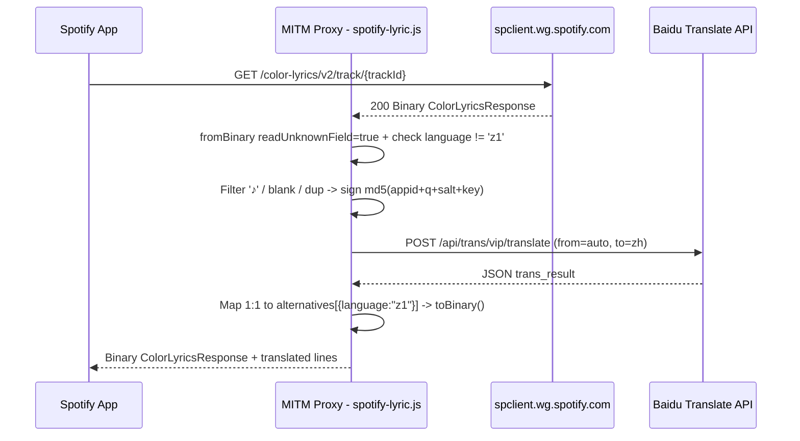

# app2smile Spotify Lyric Translation (`spotify-lyric.js`)

- **URL gốc:** `https://raw.githubusercontent.com/app2smile/rules/master/js/spotify-lyric.js`
- **Tệp trong thư mục:**
  - [`spotify-lyric.js`](./spotify-lyric.js) — Bản gốc minified (`80,887 B`, 147 dòng).
  - [`spotify-lyric.fmt.js`](./spotify-lyric.fmt.js) — Bản beautify để phân tích tĩnh (`2,959 dòng`).

## 1. Công dụng
Chặn phản hồi lời bài hát dạng Protobuf nhị phân từ `^https:\/\/spclient\.wg\.spotify\.com\/color-lyrics\/v2\/track\/` (trên `http-response` với `binary-body-mode=1`), trích xuất lời gốc không phải tiếng Trung (`language !== 'z1'`), gửi sang **Baidu Translate API** để dịch sang tiếng Trung (`zh`), và chèn bản dịch vào trường `alternatives` giữ nguyên đồng bộ từng dòng trên giao diện Spotify.

## 2. Cấu trúc file beautify (`spotify-lyric.fmt.js`)
- `L1-L39`: Hướng dẫn cấu hình Surge/Loon/QX + đối tượng `options` (`appid`, `securityKey`).
- `L40-L682`: Polyfill `text-encoding` (`TextEncoder`/`TextDecoder`).
- `L683-L2166`: Runtime `protobuf-ts 2.9.0`.
- `L2167-L2294`: Thư viện băm `js-md5`.
- `L2295-L2483`: 4 schema message Protobuf tối giản: `ColorLyricsResponse` (field `1: lyrics`), `LyricsResponse` (`2: lines`, `9: alternatives`, `10: language`), `LyricsLine` (`2: words`), `Alternative` (`1: language`, `2: lines`).
- `L2484-L2591`: Luồng xử lý dịch Baidu Translate API.
- `L2592-L2958`: `Env.min.js` (chavyleung).

## 3. Cơ chế hoạt động

1. **Giải mã Partial Protobuf giữ metadata gốc (`L2488-L2499`):** Chỉ xử lý khi `resStatus === 200`. Dùng `ColorLyricsResponse.fromBinary(binaryBody, { readUnknownField: true })` để các trường chưa khai báo trong 4 schema rút gọn (như thông tin đồng bộ thời gian/màu nền của response gốc) được giữ nguyên qua `UnknownFieldHandler`. Thoát sớm nếu `!originLanguage` hoặc `originLanguage === 'z1'`.
2. **Nạp cấu hình & Tối ưu chuỗi gửi dịch (`L2501-L2522`):** Đọc `$argument` (`appid`, `securityKey`) trên Surge/Loon hoặc dùng `options` trên QX. Gom `lyrics.lines.map(x => x.words)`, lọc bỏ dòng rỗng và `'♪'`, khử trùng lặp (`.filter((v, i, a) => a.indexOf(v) === i)`) rồi nối bằng `\n` để tiết kiệm quota ký tự API.
3. **Ký MD5 & Gọi Baidu API (`L2523-L2561`):** Tạo `salt = Date.now()`, tính `sign = md5(appid + query + salt + securityKey)`, `POST` form URL-encoded (`from: 'auto'`, `to: 'zh'`) tới `https://fanyi-api.baidu.com/api/trans/vip/translate`. Xử lý mã lỗi (`54003` giới hạn tần suất, `52003` lỗi `appid`/`securityKey`).
4. **Ánh xạ 1:1 & Tái đóng gói (`L2563-L2583`):** Tạo `Map` từ `trans_result` (`src !== dst`), rồi gán đè `lyrics.alternatives = [{ language: "z1", lines: ... }]` theo đúng thứ tự mảng `lyrics.lines` gốc (`transMap.get(word) || word || ''`) trước khi gọi `ColorLyricsResponse.toBinary(...)`.

## 4. Rủi ro bảo mật & Bug đáng chú ý
- **Rò rỉ bí mật khi lỗi `$argument` (`L2509`):** Khi parse `$argument` thất bại, `commonApi.msg(notifyName, '$argument解析失败', $argument)` in toàn bộ chuỗi `$argument` (chứa `appid` và `securityKey`) ra thông báo hệ thống và console.
- **Lỗi cắt khóa có dấu `=` (`L2506`):** `item.split('=')` làm mất phần sau dấu `=` nếu `securityKey` chứa `=`.
- **Thiếu `try/catch` & ghi đè phiên âm:** Không bọc `try/catch` quanh `ColorLyricsResponse.fromBinary` (`L2494`) và `JSON.parse(data)` (`L2551`); gán đè `lyrics.alternatives` sẽ làm mất lời phiên âm Romaji/Pinyin gốc nếu bài hát có sẵn.
- **Kiểm tra header phân biệt hoa thường:** `Env.post` (`L2829`) kiểm tra `headers['Content-Type']` viết hoa trong khi script truyền `'content-type'` chữ thường (`L2541`).
