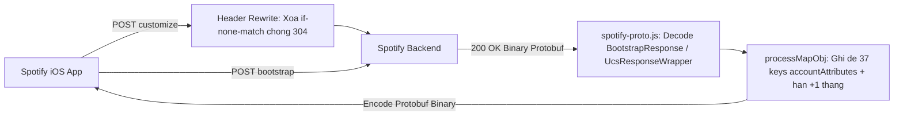

# app2smile Spotify Proto (`spotify-proto.js`)

- **URL gốc:** `https://raw.githubusercontent.com/app2smile/rules/master/js/spotify-proto.js`
- **Module tham chiếu:** `https://raw.githubusercontent.com/app2smile/rules/master/module/spotify.module`
- **Tệp trong thư mục:**
  - [`spotify-proto.js`](./spotify-proto.js) — Bản gốc minified (`71,920 B`, 89 dòng).
  - [`spotify-proto.fmt.js`](./spotify-proto.fmt.js) — Bản beautify (`2,426 dòng`).

## 1. Cấu hình module phối hợp (theo `spotify.module`)
- `[MITM]` `hostname = %APPEND% spclient.wg.spotify.com, *spclient.spotify.com`
- `[Header Rewrite]` xóa header `if-none-match` trên `user-customization-service/v1/customize` để tránh backend trả HTTP `304 Not Modified` (vốn không mang body nhị phân).
- Phối hợp cùng [`spotify-json.js`](../app2smile-spotify-json/README.md) ở pha request.

## 2. Bố cục file beautify (`spotify-proto.fmt.js`)
- `L1-L1951`: Bundled **`protobufjs` bản `light`** (`L564` `build = "light"`).
- `L1952-L2261`: JSON Protobuf descriptor `spotifyJson` (`options.java_package = "com.smile.spotify.model"`, gồm 20 message như `BootstrapResponse`, `UcsResponseWrapperV0`, `UcsResponseWrapper`, `UcsResponse`, `ResolveResponse`, `Configuration`, `AccountAttributesResponse`, `AccountAttribute`, `Error`).
- `L2263-L2303`: Kiểm tra HTTP status (`resStatus !== 200`), nhận diện runtime `QuanX` vs `Surge/Loon`, giải mã và định tuyến 2 endpoint `POST`.
- `L2305-L2426`: Hàm `processMapObj` ghi đè 37 thuộc tính trong `accountAttributes`.

## 3. Cơ chế hoạt động

1. **Nhận diện dữ liệu nhị phân (`L2265-L2273`):** Kiểm tra `resStatus === 200` (khác `200` thì gọi `$done({})`). Nếu là Quantumult X (`typeof $task !== "undefined"`), đọc `new Uint8Array($response.bodyBytes)`; trên Surge/Loon (`binary-body-mode=1`), đọc trực tiếp `Uint8Array` từ `$response.body`.
2. **Định tuyến `POST` & truy xuất map `accountAttributes` (`L2276-L2303`):**
   - URL chứa `bootstrap/v1/bootstrap`: dùng `protobuf.Root.fromJSON(spotifyJson).lookupType("BootstrapResponse").decode(binaryBody)` rồi truy xuất `ucsResponseV0.success.customization.success.accountAttributesSuccess.accountAttributes`.
   - URL chứa `user-customization-service/v1/customize`: giải mã `UcsResponseWrapper` rồi truy xuất `success.accountAttributesSuccess.accountAttributes`.
   - *(Ghi chú schema: tuy `spotifyJson` khai báo `ResolveResponse` / `Configuration.assignedValues`, code xử lý không chỉnh sửa `assignedValues`.)*
3. **Vá 37 thuộc tính quyền trong `processMapObj` (`L2305-L2426`):**
   - **Gói & tắt quảng cáo/shuffle:** `type: "premium"`, `catalogue: "premium"`, `name: "Spotify Premium"`, `player-license: "premium"`, `financial-product: "pr:premium,tc:0"`, `payments-initial-campaign: "prepaid"`, `ads: false`, `shuffle: false`, `pick-and-shuffle: false`, `shuffle-algorithm: "RANDOM"`, `on-demand: true`, `unrestricted: true`, `streaming-rules: ""`, `nft-disabled: "1"`.
   - **Audio, offline & tính năng mở rộng:** `offline: true`, `offline-backup: "UNRESTRICTED"`, `lyrics-offline: true`, `high-bitrate: true`, `audio-quality: "1"`, `loudness-levels: "1:-5.0,0.0,3.0:-2.0"`, `smart-shuffle: "AVAILABLE"`, `jam-social-session: "EXPANDED"`, `social-session: true`, `social-session-free-tier: false`, `has-audiobooks-subscription: true`, `mixing-tools: "EDIT"`, `can_use_superbird: true`, `libspotify: true`, `mobile: true`, `your-library-tags: true`, `is-euterpe: true`, `is-thalia: true`, `is-pigeon: true`.
   - **Cờ UCS bắt buộc:** Bật `com.spotify.madprops.use.ucs.product.state: true` và `com.spotify.madprops.delivered.by.ucs: true` (tránh trường hợp tài khoản bị bỏ qua response `customize`).
   - **Gia hạn động 1 tháng:** Cộng 1 tháng từ thời gian hiện tại (`expireDate.setMonth(expireDate.getMonth() + 1)`) để gán chuỗi ISO `endDateStr` cho `subscription-enddate` và `product-expiry`.
4. **Tái đóng gói & trả về:** Gọi `.encode(...).finish()`, cắt đúng slice `ArrayBuffer` trả qua `bodyBytes` trên QX hoặc `Uint8Array` qua `body` trên Surge/Loon.

## 4. Điểm yếu & Ranh giới hiệu lực
- **Bug nhánh `else` (`L2290-L2297`):** Nhánh `else` chỉ gửi notification cảnh báo lỗi khớp route nhưng **thiếu `return`**, nên code chạy tiếp xuống lệnh `body.buffer.slice(...)` trên QX khi `body` còn `undefined`, gây lỗi runtime `TypeError`.
- **Phân tích cấu trúc `oneof` trong `UcsResponse` (`L2080-L2135`):** Schema `UcsResponse` định nghĩa hai nhánh `oneof` (`resolveResult`: `ResolveResponse | Error` và `accountAttributesResult`: `AccountAttributesResponse | Error`), trong đó `Configuration.assignedValues` (`L2126-L2130`) chỉ được khai báo để `protobufjs` đọc/giữ nguyên dữ liệu Remote Config gốc khi encode lại mà không chỉnh sửa nội dung. Script cũng giả định `ucsResponseV0.success.customization.success.accountAttributesSuccess` luôn tồn tại ở trạng thái success, thiếu kiểm tra nhánh `error` nếu server trả lỗi UCS.
- **Giới hạn chất lượng âm thanh:** Quyền stream bitrate `Very High` (Ogg Vorbis 320kbps) vẫn do backend kiểm tra trước khi cấp khóa/luồng phát; chính file `spotify.module` gốc cũng cảnh báo không đặt chất lượng âm thanh ở mức tối đa.
