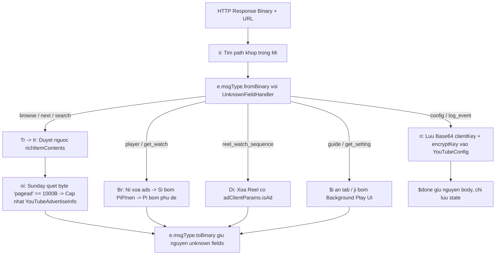

# Maasea YouTube Response (`youtube.response.js`)

- **URL gốc:** `https://raw.githubusercontent.com/Maasea/sgmodule/master/Script/Youtube/youtube.response.js`
- **Module tham chiếu:** `https://raw.githubusercontent.com/Maasea/sgmodule/master/YouTube.Enhance.sgmodule`
- **Tệp trong thư mục:**
  - [`youtube.response.js`](./youtube.response.js) — Bản gốc esbuild minified (`132,973 B`, 3 dòng).
  - [`youtube.response.fmt.js`](./youtube.response.fmt.js) — Bản beautify để phân tích tĩnh (`6,163 dòng`).

## 1. Công dụng chính
1. **Chặn quảng cáo trên Feed, Search, Next, Watch và Shorts:** Tự động nhận diện và loại bỏ node quảng cáo khỏi phản hồi Protobuf nhị phân của YouTube và YouTube Music, đồng thời ghi nhớ các ID/template đã phát hiện vào storage cục bộ.
2. **Mở khóa trình phát PiP (Picture-in-Picture) & Phát nền:** Bơm cấu trúc `pictureInPictureRender` và `backgroundPlayerRender` vào `playabilityStatus`.
3. **Bơm phụ đề dịch tự động (`&tlang=<lang>`):** Thêm track phụ đề và danh sách ngôn ngữ dịch khi tham số `captionLang !== "off"`.
4. **Tùy biến giao diện điều hướng & Cài đặt:** Ẩn tab nâng cấp `SPunlimited` và tùy chọn `FEuploads`, `FEmusic_immersive`, `FEshorts`; chèn tùy chọn `item: 151` và `backgroundPlayBackSettingRenderer`.
5. **Thu thập khóa Onesie:** Lưu `clientKey` và `encryptKey` (Base64) từ `onesieHotConfig` vào `YouTubeConfig` để companion script `youtube.request.js` xử lý trên `*.googlevideo.com/initplayback`.

## 2. Cấu trúc file beautify (`youtube.response.fmt.js`)
- `L31-L122`: Polyfill `TextDecoder` / `TextEncoder`.
- `L147-L202`: Helper Base64 (`Te` decode, `Q` encode).
- `L204-L227`: `UnknownFieldHandler` (`d`, `Symbol.for("protobuf-ts/unknown")`).
- `L343`: Runtime `@protobuf-ts/runtime` v1.0.8.
- `L1724-L5510`: 81 Protobuf message classes tự sinh thuộc 10 namespace (`youtube.component.*`, `browse`, `next`, `search`, `shorts`, `guide`, `player`, `setting`, `watch`, `config`, `ump.encrypted`).
- `L5512-L6162`: Toàn bộ logic nghiệp vụ (`Ni`, `Si`, `Pi`, `Br`, `ni`, `Ui`, `Ei`, `Fi`, `Li`, `Ir`, `Tr`, `Ai`, `Di`, `$i`, `ji`, `Vi`, `ri`, `Mi`, `ii`) và lớp adapter đa proxy `ue`/`K` (`Surge`, `Loon`, `QuanX`) + điểm vào `Ki()`.

## 3. Cơ chế hoạt động

1. **Adapter & Khởi tạo (`ue`/`K`, `Wr`/`vi`, `ai`, `Ki`):** Phát hiện `Surge`/`Loon`/`QuanX`, chuẩn hóa `bodyBytes` qua JavaScript `Proxy` (`Ve` cho Surge/Loon, `G.transferBodyBytes` giữa `ArrayBuffer` và `Uint8Array` cho QuanX). Dựa vào `User-Agent` chứa `"music"` để chọn `platformKey` là `"youtubeMusic"` hay `"youtube"`, nạp `YouTubeAdvertiseInfo` & `YouTubeConfig`.
2. **Điều phối endpoint (`Mi` & `ii`):** Khớp lần lượt 10 path (`browse`, `next`, `player`, `search`, `reel_watch_sequence`, `guide`, `get_setting`, `get_watch`, `config`, `log_event`) qua `l.url.includes(r.path)`. Giải mã nhị phân bằng `e.msgType.fromBinary`, chạy handler, chỉ gọi `toBinary` khi `bodyChanged === true`.
3. **Tự học quảng cáo bằng thuật toán Sunday (`Ir` -> `Li` -> `Ei`/`Fi` -> `ni`):**
   - `Ir` duyệt ngược mảng `richItemContents` để `splice(r, 1)` an toàn.
   - `Li` kiểm tra `d.list(l)[0]` (unknown field đầu tiên): nếu có thì gọi `Ei` tra `whiteNo`/`blackNo`; nếu không thì gọi `Fi` tách `layoutRender?.eml?.split("|")?.[0]` tra `whiteEml`/`blackEml` hoặc regex `/shorts(?!_pivot_item)/`.
   - Khi chưa có trong cache, `ni(l.data)` chạy **Sunday byte-search** (`Int32Array(256)`) trên mảng có `length >= 1000` tìm chuỗi ASCII `"pagead"` (`[112, 97, 103, 101, 97, 100]`) rồi ghi cache vào `YouTubeAdvertiseInfo`.
4. **Sửa luồng Video & UI (`Ni`, `Si`, `Pi`, `Di`, `$i`, `ji`, `Vi`, `ri`):**
   - `Ni` (`L5512`): làm rỗng `adPlacements`, `adSlots` và xóa `playbackTracking.pageadViewthroughconversion`.
   - `Si` (`L5516`): gắn `pictureInPictureRender` (`active: true`) và `backgroundPlayerRender` (`active: true`).
   - `Pi` (`L5556`): thêm `captionTrack` với `&tlang=${e}`, cập nhật `captionTrackIndices`, `defaultCaptionTrackIndex`, `captionsInitialState = 3` và bảng `translationLanguages`.
   - `Di` (`L5678`): xóa entry Shorts có `reelWatchEndpoint.adClientParams.isAd`.
   - `$i` (`L5688`): xóa mục điều hướng khớp `browseId` (`SPunlimited`, và `FEuploads`/`FEmusic_immersive`/`FEshorts` theo cấu hình).
   - `ji` (`L5705`): thêm cài đặt `item: 151` trong `categoryId === 10135` và đẩy `backgroundPlayBackSettingRenderer`.

## 4. Điểm yếu & Bug đã ghi nhận
- Cờ `debug` bị vô hiệu hóa do `K.getInstance("YouTube")` không nhận tùy chọn `{ debug }`.
- `Mi.find(r => l.url.includes(r.path))` so khớp chuỗi con toàn URL nên có rủi ro khớp nhầm query string.
- Trong `Pi()`, nếu `captionTracks` là mảng rỗng (`n.length === 0`) mà `captionLang !== "off"`, truy cập `n[o].baseUrl` sẽ ném `TypeError` và bị `catch` ngoài `Ki()` nuốt lỗi rồi gọi `F.exit()`, bỏ qua luôn bước xóa quảng cáo `Ni()` & `Si()` cho video đó.
- `adCache` (`YouTubeAdvertiseInfo`) không có TTL/cơ chế hết hạn nếu phân loại nhầm.
