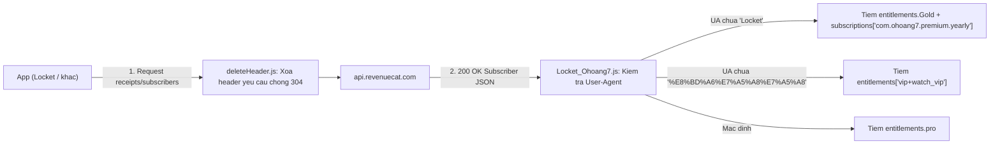

# vuong2023 Locket Gold (`Locket_Ohoang7.js`)

- **URL gốc:** `https://raw.githubusercontent.com/vuong2023/shad/main/js/Locket_Ohoang7.js`
- **Module tham chiếu:** `https://raw.githubusercontent.com/vuong2023/shad/main/modules/Locket_ohb.sgmodule`
- **Tệp trong thư mục:**
  - [`Locket_Ohoang7.js`](./Locket_Ohoang7.js) — Bản gốc (`1,298 B`, 8 dòng).
  - [`Locket_Ohoang7.fmt.js`](./Locket_Ohoang7.fmt.js) — Bản beautify (`35 dòng`).

## 1. Cấu hình MITM mục tiêu (theo `Locket_ohb.sgmodule`)
- `[MITM]` `hostname = %APPEND% api.revenuecat.com`
- `http-response`: `^https:\/\/api\.revenuecat\.com\/.+\/(receipts$|subscribers\/[^/]+$)` (`requires-body=true`).
- `http-request`: chạy script phụ `deleteHeader.js` khớp `^https:\/\/api\.revenuecat\.com\/.+\/(receipts|subscribers)` trước khi request lên RevenueCat.

## 2. Cơ chế hoạt động

1. **Pha `http-request` (trong `Locket_ohb.sgmodule`):** Chạy `deleteHeader.js` để xóa header yêu cầu (thường nhằm loại bỏ cache header để ngăn RevenueCat trả mã `304 Not Modified` không có body; lưu ý chưa tải trực tiếp `deleteHeader.js`).
2. **Kiểm tra `User-Agent` (`Locket_Ohoang7.fmt.js` `L1-L26`):** Đọc `$request.headers["User-Agent"] || $request.headers["user-agent"]` và tìm khóa trong `mapping`:
   - `'%E8%BD%A6%E7%A5%A8%E7%A5%A8'` (mã URL của `"车票票"`, dấu vết từ template RevenueCat tiếng Trung) -> entitlement `'vip+watch_vip'`.
   - `'Locket'` -> entitlement `'Gold'`.
   - Không khớp -> fallback gán `obj.subscriber.entitlements.pro`.
3. **Tiêm bản ghi entitlement & subscription giả (`L1-L34`):**
   - Gán thêm trường `obj.Attention = "Chúc mừng bạn! Vui lòng không bán hoặc chia sẻ cho người khác!"`.
   - Khởi tạo `ohoang7` (`is_sandbox: false`, `ownership_type: "PURCHASED"`, `period_type: "normal"`, `store: "app_store"`, `purchase_date: "2024-07-28T01:04:17Z"`, `original_purchase_date: "2024-07-28T01:04:18Z"`, `expires_date: "2099-12-18T01:04:17Z"`) và `vuong2023` (`product_identifier: "com.ohoang7.premium.yearly"`, `expires_date: "2099-12-18T01:04:17Z"`).
   - Khi chạy `let [e, s] = mapping[match]`, vì mọi mảng trong `mapping` chỉ có 1 phần tử nên `s` luôn là `undefined`; biểu thức điều kiện luôn ghi vào `obj.subscriber.subscriptions["com.ohoang7.premium.yearly"] = ohoang7` và `obj.subscriber.entitlements[e] = vuong2023`.

## 3. Điểm yếu & Ranh giới hiệu lực
- **Thiếu kiểm tra an toàn (`L8-L9`, `L29`):** Không kiểm tra HTTP status code, không bọc `try/catch` quanh `JSON.parse($response.body)`, không kiểm tra `obj.subscriber` tồn tại, và nếu request không gửi header `User-Agent` (cả thường lẫn hoa), `ua` mang giá trị `undefined` khiến `ua.includes(e)` ở `L29` ném `TypeError`.
- **Phân tích toán tử dấu phẩy `,` và destructuring (`L31-L33`):** Vì mọi mảng giá trị trong `mapping` (`L2-L5`) chỉ gồm 1 phần tử, `let [e, s] = mapping[match]` luôn gán `s = undefined`, nên nhánh điều kiện ternary ở `L32` luôn chạy vế `:`; tiếp đó phép gán `obj.subscriber.entitlements[e] = vuong2023` được nối sau dấu phẩy `,` (có độ ưu tiên thấp hơn toán tử ternary `? :`), nên nhánh `if` và `else` cùng hoàn tất gán hai khóa `subscriptions` và `entitlements` trong một biểu thức.
- **Client-side SDK vs Server-side receipt check:** Chỉ tác động tới SDK RevenueCat phía client; các tính năng hoặc API backend có kiểm tra trực tiếp trạng thái thuê bao từ máy chủ ứng dụng tới RevenueCat/Apple sẽ không công nhận.
